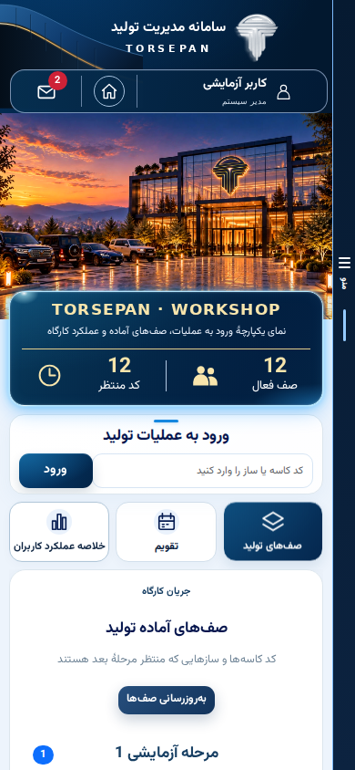

# Navy and champagne preview — 2026-10-17

The approved mobile design is now implemented as shared panel code. This branch is for review; it does not change the production deployment or production database.

## Scope

- `theme.css` defines shared navy/champagne colors, surfaces, typography, spacing, controls and responsive layout. It loads after legacy component styles and is scoped to the authenticated shell.
- `PageHero` shares the dashboard, order and export summary treatment. Counts come from existing services; preview numbers are never hardcoded into application code.
- The header retains the original logo and authenticated user information, home link and live message count. PWA installation is available in the navigation drawer.
- The 25px mobile menu rail occupies the full viewport height. Header, photograph and cards reserve its width. The content column scrolls independently; the drawer can be closed from the same rail or backdrop.
- Dashboard uses the existing workshop asset from `deploy-panel`, production code entry, queues, calendar and monthly performance tabs. Orders and export keep their event handlers, validation, permission checks and service calls.
- The latest scale tabs and compact shape/tune presentation from `deploy-panel` are preserved, so this preview does not revert those recent UI changes when based on `master`.
- The native Android mode controls are hidden in the new header presentation. Their native implementation is retained; relocation is deferred as requested. This branch does not build a new Android package.

## Baselines

Prepared from master `607d490`, with the selected existing panel UI work from deploy-panel `20d599d`. deploy-api `53d017c` was inspected; this change does not modify API, database, authentication or deployment configuration. Release branches are not reset or merged.

## Validation

Local Release build of the panel: passed. Browser checks render the actual interactive Blazor application against a localhost-only fixture, with an isolated synthetic account and synthetic data:

- Widths 360, 390, 768 and 1280; dashboard, orders and export.
- No horizontal overflow in shared header, hero, tabs, destination grid or production entry.
- Fixed rail geometry while content scrolls; drawer open/close and installation entry.
- Dashboard calendar day and view switching; order expansion, editor row add/remove and draft view.
- Export destination switching, empty search, selection and shipment dialog cancellation.
- No browser runtime errors.

Existing order-composition and export-workflow smoke suites passed locally. An additional legacy `node tests/mobile-regressions.cjs` check passes its camera/reconnection checks but fails its existing WarehouseList CSS assertion (`warehouse-detail...100vw`). That stylesheet is byte-identical to master and is not modified here; this pre-existing warehouse-layout gate must be resolved before a production release. The PostgreSQL multi-session concurrency case requires `ORDER_TEST_DB`; it is not covered by the isolated SQLite fixtures.

## Reproduce

Build with .NET 10, install Playwright outside the checkout, and run:

```sh
dotnet build TORSEPAN.Panel -c Release -m:1
THEME_PLAYWRIGHT=/path/to/node_modules/playwright bash tests/theme-preview.sh
```

`THEME_SCREENSHOTS=/path/to/output` enables mobile screenshots. `THEME_CHROMIUM` and `THEME_CHROMIUM_ARGS` optionally choose an installed browser. The dedicated GitHub Actions workflow stores screenshots as a review artifact. Fixtures and test runner are not shipped with the panel.

## Before production

Review the actual rendered mobile screenshots and accept the three pages. Complete any page-specific redesign of remaining sections in further commits, then validate the complete release in an isolated staging environment. Production publication, release-branch synchronization, Android packaging and verification of the Liara deployed SHA remain separate steps. No live deployment is claimed by this preview.

## Fidelity correction after visual review

The first code preview did not closely reproduce the approved mockup. The review identified missing Bootstrap CSS in the repository (App.razor referred to a nonexistent path), excessive vertical spacing, Unicode placeholder icons and an oversimplified header. The correction vendors Bootstrap RTL 5.3.3 with its MIT notice, adds native SVG statistics/navigation icons and architectural header artwork, and recalibrates header/profile, summary, entry and shortcut proportions. Browser checks now fail on missing CSS/JS/font/image assets as well as runtime errors. The workshop photograph remains the existing source asset rather than the slightly different AI-generated rendering in the concept. This is a remaining visible difference, not a claim of pixel-identical reproduction.

Current actual application capture (synthetic isolated account):



## Equal-scale typography and lighting review

A second review compares the approved 893px-wide application area with the actual app at the same physical display scale. Mobile text is now calibrated independently for the brand, profile, summary title, metric values, captions, form title and field placeholder, and shortcut labels. The real Vazirmatn Bold font is bundled under its OFL license instead of relying on browser-synthesized weight. The summary panel uses an independent white/cyan corner glint, blue perimeter bloom, inner reflection and gold divider. Entry-button width and the summary/form/shortcut heights are adjusted from that comparison.

`tests/theme-reference-capture.cjs` captures the actual interactive app at 390×670 CSS pixels with a 3× device scale (1170×2010 output). Run through `tests/theme-preview.sh` with `THEME_BROWSER_SCRIPT=tests/theme-reference-capture.cjs` and `THEME_REFERENCE_CONTENT=1`. That opt-in fixture copies the reference's display name, role label and 262/12 figures into synthetic local data; it does not authenticate a real user or read production data. Default regression fixtures retain their own test identity. Full-resolution screenshots are delivered separately; the checked-in preview remains a current normal-resolution app capture.

The screenshot comparison still shows differences in the workshop photograph. The architectural corner is now extracted from the supplied approved reference, as recorded below. Functional checks and this review do not assert pixel-identical reproduction or authorize production publication.

## Header placement and actual photo overlap correction

The brand group is aligned to the reference rather than the right edge of the available header. At a 390px viewport, the title starts at x=122 CSS px and the profile icon at x=302 CSS px. The toolbar now has explicit profile/home/message columns and both vertical dividers. The user region is inset to reproduce the reference composition without changing account data or routes.

The workshop photograph is extended 28px behind the summary card, and the card overlaps it by 31px. The card's overall vertical position is retained; the visible strips of photograph beside its upper corners establish genuine layering instead of placing the card after the image. Browser checks assert a 28–34px intersection and both toolbar divider/grid behavior at mobile widths, in addition to existing functional checks. Actual tested widths: 360, 390, 768 and 1280px. Panel Release build and the browser suite passed.

## Approved reference artwork and deeper navy

The architectural corner now uses actual pixels cropped from the user-supplied `1000029148(2).png` reference (source rectangle x=82..355, y=0..174), rather than the hand-drawn SVG approximation. Only its terminal right/bottom edges are feathered into the header; no text, logo, toolbar or controls are baked into this asset. The corner keeps its aspect ratio and narrows on small viewports to stay clear of the brand. The original silver logo and live controls remain separate.

Shared navy tokens are now #031e43 / #00152f / #073b73. Header, toolbar, hero panels, menu, entry buttons, selected warehouse/order tabs and dashboard shortcuts use deeper saturated blue-navy gradients. Reference navy samples include #011a39 in the header and #001a35 in the summary panel. Existing photo/card overlap, typography and fixed 25px rail geometry are retained.

Validation: Panel Release build passed (three existing application warnings). Actual Blazor browser checks passed for dashboard, orders and export at 360, 390, 768 and 1280px, including the new corner-versus-brand clearance assertion, photo/card overlap, menu scrolling behavior and existing route interactions. No runtime or missing asset errors. The updated 1170×2010 capture uses isolated synthetic data. This prepares the preview branch for review; production deployment is not performed.

## Profile-toolbar transition into workshop photograph

On dashboard mobile layouts, the top edge of the workshop scene is now extended behind the profile/home/message toolbar using a masked reflected edge. The transition fades from the header navy to the photograph at the exposed left/right margins; the toolbar remains a separate live element above it. The existing photograph scale, visible framing, summary overlap, header height and scroll geometry are preserved. The effect is scoped to the dashboard; orders and export retain their plain shared headers. Browser checks at 360, 390, 768 and 1280px cover the existing menu, layout and route interactions. The actual high-resolution capture was visually checked at the toolbar margins. Production remains unchanged.
